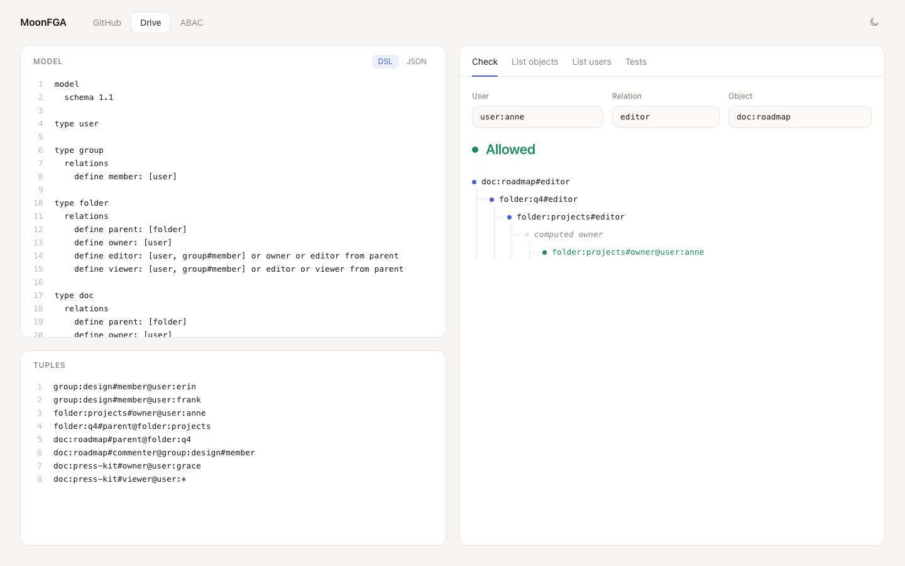

# MoonFGA

**[在浏览器里试用 →](https://sundaysebasidian-byte.github.io/moonfga/)**

<picture>
  <source media="(prefers-color-scheme: dark)" srcset="docs/assets/playground-dark.png">
  
</picture>

MoonFGA 是用 MoonBit 写的 OpenFGA 兼容授权（ReBAC）引擎：把"谁对什么对象有什么关系"存成元组，
按模型规则推导"这个人能不能访问那个资源"。支持 OpenFGA schema 1.1 建模语言、JSON 授权模型、
元组存储、`Check`、`BatchCheck`、`ListObjects`、`ListUsers`、`Expand`、可解释的 Check，以及用于
条件关系的自实现 CEL 子集。库在 native、wasm-gc 和 JavaScript 三个后端都能构建和测试，
Playground 就是同一个引擎编译成 JS 在浏览器里跑。

"OpenFGA" 是 OpenFGA 项目的商标。MoonFGA 是独立实现，未获 OpenFGA 项目背书。

文档：[一致性测试结果](docs/conformance.md) · [设计说明](docs/design.md) ·
[性能](docs/performance.md) · [提案](docs/proposal.md) · [更新日志](CHANGELOG.md)

## 评审入口

汇总数字都能跳到原始证据。注意：ListUsers 是 393/394，有 **1 条断言被跳过**，没有失败，也不计入通过。

| 要看什么 | 汇总 | 原始证据与复现 |
| --- | --- | --- |
| 固定版本的上游矩阵 | OpenFGA v1.22.1（commit `44054f54`）：Check 516/516，ListObjects 354/354，ListUsers 393/394（1 skip）；语言夹具 29/29 | [`docs/conformance.md`](docs/conformance.md) 的 Summary 与逐断言表；固定 commit 写在 [`scripts/fetch-upstream.sh`](scripts/fetch-upstream.sh)；`scripts/fetch-upstream.sh && ./scripts/conformance.sh` |
| 唯一的 skip | `simple_computeduserset_indirect_ref`（list_users，`consolidated_1_1_tests.yaml`）：期望值嵌在 request 里，没有顶层 `expectation` 或 `errorCode`，记为 `skip/no_expectation` | [`docs/conformance.md` 的 Failure categories](docs/conformance.md#failure-categories)；逐断言表编号 57 |
| 随机差分 | seed 314159、271828 各 1095 组（1000 随机＋95 定向），共 6570 次比较，0 不一致；定向脚本 204 组 / 612 次比较，0 不一致 | [`docs/evidence/oracle-summary.json`](docs/evidence/oracle-summary.json)、[`oracle-seed271828-summary.json`](docs/evidence/oracle-seed271828-summary.json)、[`directed-summary.json`](docs/evidence/directed-summary.json)；命令见 [同版本差分](docs/conformance.md#同版本差分与定向回归) |
| 性能条件 | 1 万 / 10 万 / 100 万元组，三种扇出、20 层 group；native 与 JS release 的 p50/p95/max、峰值 RSS、图构建占比，macOS arm64 合成数据 | [实验方法](docs/performance.md)、[完整测量表](docs/evidence/scale-results.md)；`python3 scripts/performance.py optimized` |
| 安装包调用 | `moonfga@0.1.1` 在全新模块中构造模型和元组后 Check，输出 `anne can view roadmap: true` | 见下表“版本对应” |

## 版本对应

| 面 | 对应 | 说明 |
| --- | --- | --- |
| 发布源码 | tag `v0.1.1` | mooncakes 0.1.1 的打包内容与该 tag 指向的提交一致 |
| mooncakes | `sundaysebasidian-byte/moonfga@0.1.1` | 包内容固定，不随 main 变化 |
| Pages | 最近一次推送到 main 的构建 | [`pages.yml`](.github/workflows/pages.yml) 每次 push 到 main 都会重新构建，可能领先于 0.1.1 |

当前本地源码版本为 0.1.1（未发布、未打 tag）；本节的发布包与 Pages 信息不代表本地 0.1.1 已上线。

定位发布提交：`git rev-list -n 1 v0.1.1`。下面三条命令分别复现三个面：

```bash
# 源码测试
git checkout v0.1.1
moon test --target all

# 安装包调用：在仓库外新建模块，复制 examples/library 的 main.mbt 和 moon.pkg 到 cmd/main
moon new consumer && cd consumer
moon add sundaysebasidian-byte/moonfga@0.1.1
moon run cmd/main

# 线上引擎：打开 Pages；对应的构建见 Actions 中 Pages 工作流的运行记录
gh run list --workflow pages.yml --limit 1
```

## 为什么做这个

- 在 MoonBit 上提供一个能直接嵌入的 Zanzibar / OpenFGA 风格授权引擎。
- 兼容性以 OpenFGA 官方测试为准，而不是实现一个"看起来像"的 API。
- 引擎是内存实现，不依赖网络和数据库，同一套模型与元组可以在服务端和浏览器里运行。

## 与 OpenFGA 的一致性

直接回放 OpenFGA v1.22.1 的 Check / ListObjects / ListUsers / ABAC 测试矩阵（固定 commit）：

| API | 通过 | 总数 | 失败 | 跳过 |
| --- | ---: | ---: | ---: | ---: |
| Check | 516 | 516 | 0 | 0 |
| ListObjects | 354 | 354 | 0 | 0 |
| ListUsers | 393 | 394 | 0 | 1 |

`openfga/language` 的 DSL ↔ JSON 转换夹具是 29/29。

唯一跳过的断言来自上游用例 `simple_computeduserset_indirect_ref`：它的 `expectation: nil` 嵌在
request 里面，没有顶层期望值或 `errorCode`，所以按 `skip/no_expectation` 如实记录，不算通过。

除了固定用例，还和官方 v1.22.1 二进制做了随机差分：两个 seed 各 1095 组（1000 随机＋95 定向），共 6570 次比较，
0 不一致。另有独立定向差分脚本 `scripts/oracle_directed.py`，204 组 / 612 次比较，0 不一致。随机生成覆盖 CEL 逻辑错误、Unicode、timestamp 与深链；这些反例已固化为三后端测试，见
[差分报告](docs/conformance.md)。性能实测与复现命令见
[performance.md](docs/performance.md)。

## 覆盖矩阵

| 能力 | 状态 | 说明 |
| --- | --- | --- |
| Schema 1.1 DSL | 支持 | `model`、`schema 1.1`、`type`、`relations`、`define`、`[user, group#member, user:*, user with cond]`、`or` / `and` / `but not`、括号、computed userset、tuple-to-userset、`condition`、注释 |
| AuthorizationModel JSON | 支持 | 导入、导出；`schema_version`、`type_definitions`、`relations`、`metadata.relations`、`conditions` |
| 模型校验 | 支持 | 未知类型/关系、元组限制、禁止的循环、重复定义、条件参数类型；错误带行列位置 |
| 元组存储 | 支持 | 内存索引（按 `object#relation`、按 user）、写入/删除、上下文元组覆盖层、`TupleReader` trait |
| Check | 支持 | 完整 Check 请求深度预算 25、终端 join 不额外 dispatch、computed alias 迭代折叠、循环检测、通配符、union/intersection/difference 短路、TTU、条件求值 |
| BatchCheck | 支持 | 进程内批量执行，逐项返回结果或错误 |
| ListObjects / ListUsers | 支持 | 反向对象证明 / 用户集合展开、独立深度与条件错误传播、wildcard、userset 过滤器、contextual 合并语义 |
| Expand | 支持 | 返回关系重写树 |
| Explain | 支持 | 返回允许/拒绝的解析路径（`--explain`，Playground 里画成树） |
| CEL 子集 | 支持 | `int` / `uint` / `double` / `bool` / `string` / `duration` / `timestamp` / `list` / `map` / `ipaddress`，运算符、三元表达式、`exists` / `exists_one` / `all` / `map` / `filter`、常用字符串/时间/网络方法 |
| CLI | 支持 | `validate`、`transform`、`check`、`list-objects`、`list-users`、`expand`、`test` |
| `.fga.yaml` 测试 | 支持 | `model` / `model_file`、全局与用例元组、Check / ListObjects / ListUsers 断言、`errorCode` |
| ReadChanges | 不支持 | 内存存储没有变更日志 |
| FGA Modules | 支持 | schema 1.2；宿主传入文件内容并合并，保留 module / source_info；CLI 安全文件读取限 native（POSIX）/ JS；错误列表非逐条兼容 |
| 持久化存储 / HTTP / gRPC | 不支持 | 只提供可嵌入的内存引擎和 CLI，持久化需要调用方自己封装 |
| 分页、consistency preference | 不支持 | List 接口一次返回全部结果 |

## Playground

页面是纯静态的（HTML + CSS + 原生 JS，无框架、无 CDN），引擎由 `playground/` 包编译到 JS。
左边编辑模型（DSL 或 JSON）和元组，错误会标到具体行；右边查询 Check / ListObjects / ListUsers，
Check 的解析路径画成树（解释不完整时结果旁标出 Incomplete），Tests 标签页直接运行 `.fga.yaml`。内置 GitHub、Drive、ABAC 三个示例。

本地构建并打开：

```bash
scripts/build-web.sh
node web/smoke.mjs                  # 对内置示例做冒烟断言
python3 -m http.server -d web/dist  # 然后访问 http://localhost:8000
```

`playground` 包导出 7 个函数，输入输出都是 JSON 字符串，错误以 `{"ok":false,"error":{...}}`
返回，不抛异常：`validate_model`、`dsl_to_json`、`json_to_dsl`、`check`、`list_objects`、
`list_users`、`run_tests`。请求字段见 [`playground/api.mbt`](playground/api.mbt) 的注释。
`.fga.yaml` 在浏览器里必须用内联的 `model:`；`storetest` 只负责解析和运行，`model_file` 由调用方提供读取函数（CLI 会提供）。

推送到 `main` 后，[`pages.yml`](.github/workflows/pages.yml) 会构建、跑冒烟测试并发布到 GitHub Pages。

## 安装与构建

在已有 MoonBit 模块中安装：

```bash
moon add sundaysebasidian-byte/moonfga@0.1.1
```

从源码构建：

```bash
git clone https://github.com/sundaysebasidian-byte/moonfga
cd moonfga
export PATH="$HOME/.moon/bin:$PATH"
moon check --deny-warn
moon test
```

三个后端都能跑测试：

```bash
moon test --target native
moon test --target wasm-gc
moon test --target js
```

## 库 API 快速开始

在 `moon.pkg` 中加入依赖：

```moonbit
import {
  "sundaysebasidian-byte/moonfga/fga",
  "sundaysebasidian-byte/moonfga/dsl",
  "sundaysebasidian-byte/moonfga/store",
  "sundaysebasidian-byte/moonfga/engine",
}
```

最小示例（完整版本见 `examples/library/main.mbt`）：

```moonbit
let model = @dsl.parse_model(
  "model\n  schema 1.1\n\ntype user\n\ntype group\n  relations\n    define member: [user]\n\ntype document\n  relations\n    define viewer: [user, group#member]\n",
)
let store = @store.MemoryStore::new()
let _ = store.write(
  @fga.Tuple::{ object: "group:eng", relation: "member", user: "user:anne", condition: None },
)
let _ = store.write(
  @fga.Tuple::{ object: "document:roadmap", relation: "viewer", user: "group:eng#member", condition: None },
)
let engine = @engine.Engine::new(model, store as &@fga.TupleReader)
let allowed = engine.check("document:roadmap", "viewer", "user:anne")
println(allowed.to_string()) // true
```

运行：

```bash
moon run examples/library
```

常用接口：

- `@dsl.parse_model(dsl)` / `@model.json_to_model(json)` / `@model.model_from_source(source)`
- `@model.model_to_json(model)` / `@dsl.to_dsl(model)`
- `@validate.validate_model(model)` 返回带位置的 `ValidationIssue`
- `@store.MemoryStore::{ new, write, write_all, delete, read }`
- `@engine.Engine::{ check, check_with, batch_check, list_objects, list_users, expand_json, explain_check }`

自定义存储宿主见 [`examples/tuple-reader`](examples/tuple-reader/README.md)：包含独立快照实现、空结果与读取失败契约测试。

## CLI

```bash
# 校验 DSL 或 JSON 模型
moon run cmd/main -- validate examples/basic/model.fga

# DSL -> JSON / JSON -> DSL
moon run cmd/main -- transform examples/basic/model.fga --to json
moon run cmd/main -- transform examples/basic/model.fga --to dsl

# Check（--explain 打印解析路径）
moon run cmd/main -- check \
  --model examples/basic/model.fga \
  --store examples/basic/tuples.fga \
  --object document:budget --relation viewer --user user:bob --explain

# ListObjects / ListUsers
moon run cmd/main -- list-objects \
  --model examples/basic/model.fga --store examples/basic/tuples.fga \
  --type document --relation viewer --user user:bob
moon run cmd/main -- list-users \
  --model examples/basic/model.fga --store examples/basic/tuples.fga \
  --object document:budget --relation viewer --filters user

# Expand 关系树
moon run cmd/main -- expand \
  --model examples/basic/model.fga --store examples/basic/tuples.fga \
  --object document:budget --relation viewer

# 条件（ABAC）示例
moon run cmd/main -- check \
  --model examples/abac/model.fga --store examples/abac/tuples.fga \
  --object document:plan --relation viewer --user user:dana \
  --context '{"office":"hq","allowed":["remote"]}'

# 运行 .fga.yaml 测试
moon run cmd/main -- test examples/basic/store.fga.yaml
moon run cmd/main -- test examples/abac/store.fga.yaml
```

元组文件支持三种格式：JSON 数组、YAML（`tuples:`），以及每行一条 `object#relation@user` 的文本；
带条件时写作 `document:1#viewer@user:anne[in_ip:{"ip":"10.0.0.1"}]`。

## 一致性测试复现

上游测试数据不提交到仓库。`scripts/fetch-upstream.sh` 按固定 commit 把它下载到被
`.gitignore` 忽略的 `.upstream/`，数据的许可证是 Apache-2.0。

```bash
scripts/fetch-upstream.sh          # 首次运行，固定 commit
./scripts/conformance.sh           # 运行两个矩阵并检查 95/90 阈值
moon run cmd/language              # DSL <-> JSON 夹具，29/29
```

`./scripts/conformance.sh` 会在 `conformance-results/` 写入 `summary.txt` 和 `summary.json`
（均被忽略）；Check 低于 95% 或 ListObjects/ListUsers 低于 90% 时返回非零退出码。
逐断言结果见 [`docs/conformance.md`](docs/conformance.md)。

## 与 jhshuai/moonpolicykit 的区别

MoonFGA 是独立的 OpenFGA 兼容实现，没有复用 `moonpolicykit` 的代码，也不以它的超集为目标。
区别在验收方式和范围：

- MoonFGA 直接回放 OpenFGA 官方 Check / ListObjects / ListUsers / ABAC 测试矩阵，
  兼容性由上游用例定义，而不是自定义语义。
- 覆盖 OpenFGA schema 1.1 的 DSL、AuthorizationModel JSON、条件关系和 `.fga.yaml` 测试格式。
- 自带 OpenFGA 语义的 CEL 子集（含 `timestamp`、`duration`、`ipaddress`），不依赖通用策略表达式引擎。
- `moonpolicykit` 是另一个 MoonBit 策略/授权项目，它的能力与 API 以该项目文档为准；
  两者不是替代关系。

## 限制与路线图

明确不支持：FGA modules、ReadChanges、持久化/分布式存储、HTTP/gRPC 服务端、分页与
consistency preference、完整 CEL 标准库（如 `bytes`、正则捕获组等）。

后续优先级：

1. 可插拔持久化存储与变更日志（ReadChanges）。
2. 服务端 API（HTTP/gRPC）与一致性偏好。
3. 模块诊断列表与官方诊断格式进一步对齐。
4. 扩展 CEL 标准库，错误定位更细。

## 许可证

Apache-2.0，见 [`LICENSE`](LICENSE) 和 [`NOTICE`](NOTICE)。上游一致性测试数据只在本地按固定 commit
下载，不随仓库分发。

## 多文件模型

`examples/modules/fga.mod` 使用 schema 1.2，`contents` 按清单顺序列出相对 `.fga` 路径。
每个文件以 `module <name>` 开头；`extend type` 可引用后出现文件中的类型。
同一 module 名可以跨文件组成一个命名空间（官方 board 用例如此）；类型、关系、条件重复定义及重复文件会报错。
跨文件引用与递归使用现有模型校验；无入口的关系循环被拒绝。

```sh
moon run cmd/main --target native -- validate examples/modules/fga.mod
moon run cmd/main --target native -- transform examples/modules/fga.mod --to json
moon run cmd/main --target native -- transform examples/modules/fga.mod --to dsl
moon run cmd/main --target native -- test examples/modules/store.fga.yaml
python3 scripts/test-modules.py
```

库入口：`@model.parse_mod(source)` 返回内容路径；
`@model.modules_to_model(source, files)` 接受 `Array[@dsl.ModuleFile]`（`name`、`contents`），完成合并和语义校验；
`@dsl.merge_modules(files)` 是只解析合并的底层入口。
三个库后端均不需要文件系统。JSON 导入导出保留类型、扩展关系和条件的来源元数据；
DSL 输出是完整的单文件模型，不保留模块拆分或来源注释。

CLI 拒绝绝对路径、父目录、编码路径、反斜杠及符号链接逃逸。
文件系统接口缺少 canonical path 能力的 wasm CLI 会明确拒绝 `.mod` 文件读取，请使用 native / JS 或宿主内容 API。
读取期间宿主必须保持路径稳定；不保证抵抗并发替换符号链接。
`.fga.yaml` 的 `model_file: fga.mod` 使用相同加载规则。

新增官方用例：2/2 完整 JSON 转换、4/4 错误模型拒绝、9/9 fga.mod 接受／拒绝。
`06-complex-module` 上游没有模块输入，仅验证其 JSON 元数据往返；不计入模块输入通过数。
错误沿用 E2000 和 1-based 行列，模块语义错误附来源；不承诺官方全部诊断列表、精确措辞或 token 范围一致。
